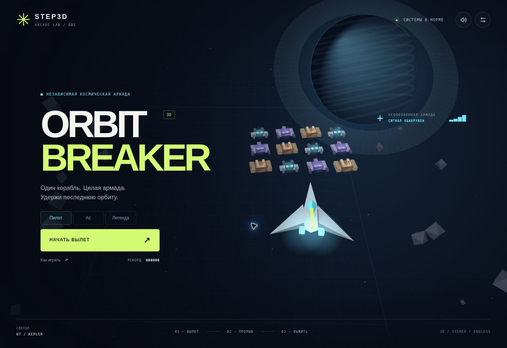

# Проверка ORBIT BREAKER

Дата: 31 октября 2026.

- Синтаксис всех модулей JavaScript проверен Node.js.
- 6 автоматических тестов симуляции пройдены: попадания и очки; импульс и перезарядка; урон и щиты; усиления; босс и переход к следующему сектору; длительная игра.
- Детерминированная симуляция: 180 секунд, 19 волн, максимум 33 одновременно активных снаряда. В этом нагрузочном тесте неуязвимость включена специально; это не оценка сложности для игрока.
- В браузере проверены запуск, автоматический огонь, импульс, начисление очков, пауза, настройки и возврат на базу.
- Проверена вёрстка на 1363 × 936 и в окне 390 × 844.
- Проверен запуск с публичного адреса GitHub Pages.

Ограничения проверки: браузер среды не предоставляет WebGL. Визуальная проверка выполнена на резервном программном 3D-рендерере. Аппаратный WebGL-рендер, реальный сенсорный экран и прослушивание аудио на физическом устройстве требуют отдельного теста.

Запуск тестов из папки игры: `node --test tests/core.test.mjs`.
